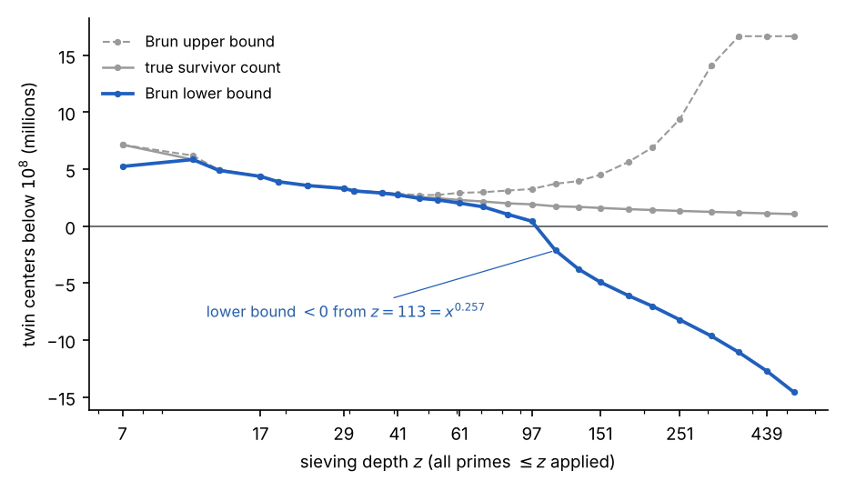
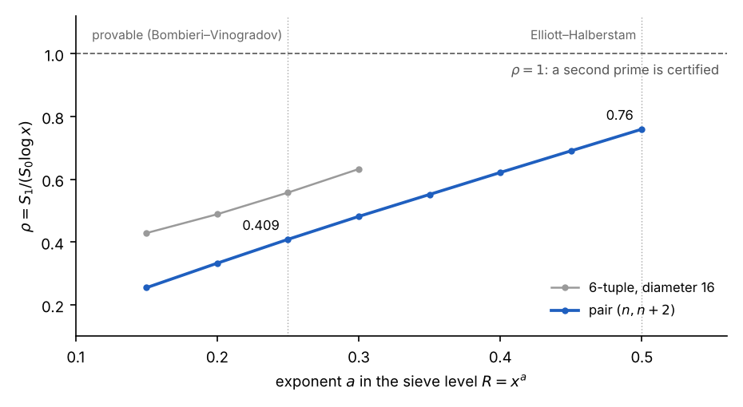
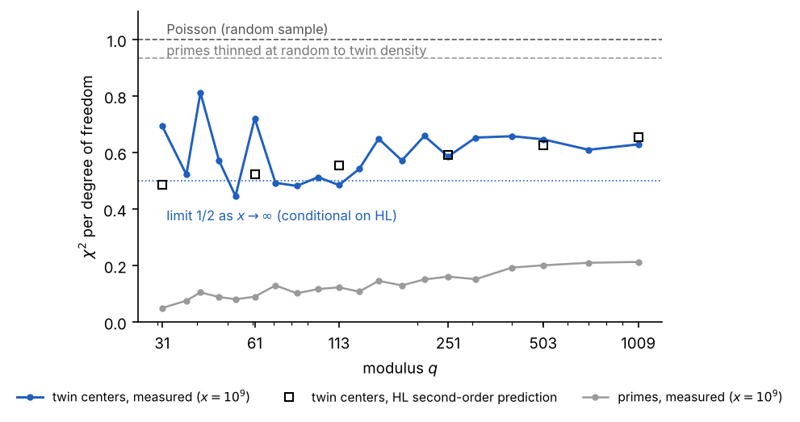

# Every Prime Is Born a Twin

*What a homemade sieve can — and cannot — say about twin primes*

*Anthony Phillips · 2 November 2026*

## The pattern

Every prime above 3 is of the form 6x − 1 or 6x + 1. That is the whole observation I started from, and it is exact: 2 removes every even number, 3 removes every third one, and what is left in each block of six is the pair {6x − 1, 6x + 1}. Every prime is born as half of a twin pair. Most lose their twin later.

I wanted to see how later primes do the killing, so I built a ruler. Multiply the primes used so far: 2·3 = 6, 2·3·5 = 30, 2·3·5·7 = 210. Call that product P. Inside one period of length P, mark which numbers no prime ≤ p divides. Those are the only candidates for primes above p. For P = 30 the survivors are {1, 7, 11, 13, 17, 19, 23, 29}; for P = 210 there are 48 of them.

The recursion is the part I had not seen written down. To get the next wheel from the previous one:

1. Tile the previous survivors p times across the new period.
2. Remove p × (each previous survivor).

From 6 to 30: tile {1, 5} five times, giving ten candidates; remove 5·1 = 5 and 5·5 = 25; eight survive. From 30 to 210: tile the eight survivors seven times, remove 7·{1, 7, 11, 13, 17, 19, 23, 29} = {7, 49, 77, 91, 119, 133, 161, 203}; 48 survive. Each new prime removes exactly one copy of the old wheel, scaled by itself, so the count goes

$$
\varphi(p\#) = (p-1)\,\varphi\big((p^{-})\#\big) = \prod_{q \le p} (q-1)
$$

Two things fall out. The survivors are symmetric about P/2 (if r survives, P − r survives), which is why the pattern can be written as 30x ± {1, 7, 11, 13}. And the wheel for p only certifies primes below the square of the next prime: the 6x ± 1 ruler is perfect up to 25, the 30-wheel up to 49, the 210-wheel up to 121. Beyond that line, survivors are candidates, not primes.

## What the wheel already knows

None of this is new, and that is the first useful thing to learn. The ruler is wheel factorization, the recursion is the Chinese Remainder Theorem (units mod 30 are pairs of units mod 6 and mod 5: 2 × 4 = 8), and the survivor count ∏(q − 1) is Euler's totient of the primorial. The sieve of Eratosthenes, Euler and Gauss got here first.

The wheel also carries two deeper facts. The surviving fraction ∏(1 − 1/q) goes to zero, but slowly: Mertens proved in 1874 that it behaves like e^(−γ)/ln p. So the wheel never runs out of candidates, their density just thins like 1/ln p, which is the Prime Number Theorem's shape. And if you count survivors that keep their twin (both r and r + 2 survive) the count is ∏(q − 2) instead of ∏(q − 1), and the ratio of twin density to the square of prime density converges:

$$
\prod_{q \ge 3} \frac{1 - 2/q}{(1-1/q)^2} = C_2 = 0.660162\ldots, \qquad 2C_2 = 1.32032\ldots
$$

That is the twin prime constant of Hardy and Littlewood (1922). Computed from the wheel alone it reaches 0.660162 by q = 10⁵. Their conjecture, that the number of twin pairs below x is about 2C₂·x/(ln x)², is what the wheel predicts if primes behave independently after sieving. The question is whether they do.

## Twin primes as survival

The twin prime conjecture, in wheel language, is: for every wheel, some pair {6x − 1, 6x + 1} survives below the certification line, and this never stops. It is cleaner to track the centers. A twin pair is (n − 1, n + 1) with 6 | n, and both survive the p-wheel exactly when n ≢ ±1 (mod q) for every prime q ≤ p. Each odd prime forbids two residues for the center; that is where ∏(q − 2) comes from. Equivalently, n² − 1 has no prime factor below √n.

Two tempting shortcuts fail, and it is worth seeing why. Euclid's trick, n = p# so that n ± 1 are coprime to every prime up to p, does produce twins at 6 ± 1, 30 ± 1 and 2310 ± 1 (5/7, 29/31, 2309/2311). Then 30031 = 59 · 509 and the construction never works again up to at least 15 primes. The number grows like p# while the protection only reaches p; every prime between p and √(p#) gets a vote. Euclid needs one new factor to exist, which is free; twins need every factor to be absent, which is the full strength of primality.

The second shortcut is to argue that the wheel kills a growing fraction, so eventually it kills everything. The fraction does go to 100%, but Mertens pins the rate: survivors below x number about x·∏(1 − 2/q) ≈ c·x/(ln x)², which diverges. Density to zero, count to infinity, the same way primes themselves behave. For twins to die out, the primes would have to conspire against the product rule by an unbounded factor, and nothing observed up to 10¹⁸ (808 trillion pairs) hints at that.

The largest known twin pair, 2996863034895 · 2^1290000 ± 1 (388,342 digits, [found by PrimeGrid in 2016](https://en.wikipedia.org/wiki/Twin_Prime_Search)), shows what a survivor actually looks like. Its center is divisible by 2, 3 and 5 and then sits on an unremarkable residue for every other prime: 2 mod 7, 4 mod 11, 2 mod 13, 3 mod 17. Of the 45 odd primes below 200, it dodges ±1 by structure for two and by luck for 43. The 2^1290000 is there so the pair can be proven prime with the Proth and Lucas–Lehmer–Riesel tests, not to help it survive. A little Euclid, then no pattern.

## Experiment 1: the instrument

The twin-center wheel, coded in NumPy, matches the published twin counts exactly at every power of ten up to 10⁸ (440,312 pairs) and, with a segmented sieve, at 10⁹ (3,424,506) and 10¹⁰ (27,412,679). Hardy–Littlewood's prediction is within 0.01% at 10⁸. Mertens' product converges to 1 to five decimals. That is the bench everything else runs on.

Inside a 10⁷ window, the rule "each prime kills 2/q of the remaining centers" is exact to 0.01% up to q = 71, then drifts: +1.1% at q = 229, −2% at 523, −9% at 1187, −12% at 1789. The product rule is only exact over a full period, and 229# is already astronomically larger than 10⁷. That drift is the error term of sieve theory, seen live.

| sieve depth q | survivors below 10⁷ | product rule | ratio | certified twins (below next q²) |
| --- | --- | --- | --- | --- |
| 7 | 714,285 | 714,286 | 1.0000 | 8 |
| 31 | 310,456 | 310,458 | 1.0000 | 42 |
| 71 | 216,138 | 216,196 | 0.9997 | 123 |
| 229 | 139,132 | 137,560 | 1.0114 | 733 |
| 523 | 102,414 | 104,408 | 0.9809 | 2,918 |
| 1187 | 75,077 | 82,363 | 0.9115 | 11,058 |
| 1789 | 65,018 | 73,573 | 0.8837 | 22,360 |
| 3163 | 58,897 | 63,923 | 0.9214 | 58,897 |

The last column is the conjecture in empirical form: survivors below the next prime's square are genuine twin primes, and the column roughly doubles at each step. Proving it never reaches zero is the whole problem.

There is a known paradox hiding in the ratio column. Sieve to √x with the product rule and you predict 2e^(−γ) ≈ 1.12 times too many primes, and 4e^(−2γ) ≈ 1.26 times too many twins; the true-to-predicted ratio for twins should approach 0.79. Measured: 0.995 at 10⁵, 0.944 at 10⁶, 0.922 at 10⁷, sliding toward 0.79 as the theory says. Primes are more correlated than independence assumes, and twice as much for pairs.

## Experiment 2: the parity wall as a curve

Brun's sieve is the wheel made rigorous: truncate inclusion–exclusion at depth r, bound every term's rounding error by 2^ω(d), and the truncated sums bracket the true count. Up to depth z ≈ 50 the bracket is tight: at z = 47 the bounds are 2.44M and 2.72M around a truth of 2.55M. Then the error budget, Σ 2^j·C(m, j) over m primes, outruns the main term.

*Figure 1. phase1.py, x = 10^8, Bonferroni truncation of inclusion–exclusion with error ±2^ω(d) per term.*

The main term is not the problem: at z = 113 the product rule predicts the truth to 1%. The sieve simply cannot afford the error it must allow. Survivors at depth 113 have all prime factors above 113, so each of n − 1, n + 1 has at most 3 prime factors (Brun's 1919 theorem gives a fixed 9 for all x). Certifying primes needs depth √x = 10,000, twice as deep in the exponent as the sieve can see. Selberg's weights push the death point out, Chen's refinement reaches "prime and at-most-two-factors", and Selberg's parity theorem says this road never reaches the exponent 0.5.

## Experiment 3: why 246 and not 2

The modern engine replaces "survived or not" with a weight. Goldston, Pintz and Yıldırım (2005) give each n a weight w(n) = Σ λ\_d over d | (n − 1)(n + 1), d ≤ R, large when n ± 1 have no small factors, then compare S1 = Σ\[θ(n − 1) + θ(n + 1)\]·w² with S0 = Σ w². If ρ = S1/(S0 ln x) exceeds 1, some n must have both neighbours prime. The catch is R: the asymptotics are provable only for R ≤ x^(θ/2), and the proven level of distribution is θ = 1/2.

*Figure 2. phase2.py, x = 10^7, weights λ_d = μ(d)(log(R/d)/log R)^k, best of ℓ = 0, 1, 2 shown.*

Run on real primes, ρ for the pair is 0.41 at the provable level and 0.76 at the Elliott–Halberstam level, which nobody can prove. Extrapolating the near-linear trend, ρ = 1 would need a ≈ 0.66, i.e. θ ≈ 1.3, and θ cannot exceed 1 by definition. This is no longer an error-term problem: even with every conjecture granted, GPY weights on a pair cannot certify two primes.

Larger tuples do better (the 6-tuple reaches 0.56 at the provable level), but with θ = 1/2 the GPY ratio tends to exactly 1 from below as the tuple grows. Maynard's 2013 change was to weight each coordinate separately; the ratio then grows like ln k and crosses 1 at k ≈ 105. The tightest admissible 105-tuple has diameter 600, later optimised by Polymath to 246. That is why bounded gaps are a theorem and gap 2 is not: a proof of twin primes needs an ingredient the weights do not contain.

## Experiment 4: hunting for structure to 10¹⁰

If a proof exists, it needs an input the sieve cannot generate: something that tells "prime" apart from "product of two large primes" (Selberg's parity problem). The only time that barrier has been broken, Friedlander and Iwaniec's primes of the form a² + b⁴ (1998), the sequence had a hidden two-variable structure that produced bilinear sums. So the question for the data is whether twin centers show any statistical structure beyond what the wheel plus Hardy–Littlewood predict. Seven probes, all on real twins to 10⁸, one to 10¹⁰.

Six came back exactly as the wheel predicts.

- Divisibility: P(5 | center) = 0.3328 against the wheel's 1/3; P(7 | center) = 0.2001 against 1/5; and so on to 47, all to four digits. Twin centers prefer small factors by exactly 1/(q − 2) instead of 1/q, which is why the record twin has its 3·5 prefix.
- 2-adic valuation: geometric, 2^(−j), to three digits. The 2^1290000 in the record is a testing convenience.
- Prime pairs at distance 4, 6, 210 and 246 occur in the Hardy–Littlewood ratios to distance 2: 0.9999, 1.9984, 3.2003, 2.0499 against predicted 1, 2, 3.2, 2.0513. Distance 2 is not special in any way the data can see.
- The two-point Möbius sum Σ μ(n)μ(n+2) stays at random-walk size (±1,000 out of 10⁸ terms); the logarithmic average that Tao proved tends to zero is at 0.019 and falling.
- Conditioned on surviving to depth z, twins briefly seemed to have fewer prime factors than other survivors (z-score −8). Restricting to a fixed window killed it: it was size bias, twins sit at smaller n than uniform survivors.
- A direct Type II test, the λ(a)-weighted residual of #{b : ab is a twin center} against the wheel model, sits within ±1.7σ in every dyadic block from a = 2 to 16384.

The seventh was different.

*Figure 3. calib.py, thin.py and hl2.c, x = 10^9; the thinning reference is the mean of three random seeds; squares are the second-order Hardy–Littlewood prediction.*

Twin centers fill the allowed residue classes mod q more evenly than a random sample would: χ² per degree of freedom around 0.6 instead of 1, with every p-value at 0.99–1.00, which is as abnormal as 0.01. Primes themselves are far more rigid (0.05–0.25, growing with q and shrinking with x, the Montgomery–Soundararajan shape), and that is expected. But thinning the primes at random to twin density gives 0.93, so "p + 2 is prime" is not acting like an independent selection. The effect held flat from 10⁸ to 10¹⁰ and from q = 31 to 1009, survived the size-bias check, the random-thinning control, and the center-convention check (using p − 1 instead of p + 1 gives identical numbers).

## The surprise, explained

The extra order is Hardy–Littlewood at second order. Twin pairs are correlated with each other: the number of n such that n ± 1 and n + h ± 1 are all prime is governed by the singular series S₄(h) of the 4-tuple {−1, 1, h − 1, h + 1}. Write ρ(h) = S₄(h)/(2C₂)² for the correlation of twin centers at distance h. It is zero unless 6 | h, and then

$$
\rho(h) = 6 \prod_{p \ge 5} f_p(h), \qquad f_p(h) = \begin{cases} 1/(1-2/p) & p \mid h \\ (1-3/p)/(1-2/p)^2 & h \equiv \pm 2 \pmod p \\ (1-4/p)/(1-2/p)^2 & \text{otherwise} \end{cases}
$$

and its average over h is exactly 1 (computed: 0.99999 over h ≤ 10⁷). The expected value of the χ² statistic follows by summing these correlations over h ≡ 0 (mod q) and subtracting the all-h average, the same mechanism that gives the primes' Montgomery–Soundararajan rigidity:

$$
E\Big[\sum_c (T_c - T/K)^2\Big] = T\Big(1-\tfrac{1}{K}\Big) + \Big(\tfrac{T}{x}\Big)^2 \cdot 2\sum_{0<h<x} \rho(h)\,(x-h)\,\Big[\mathbf{1}_{q \mid h} - \tfrac{1}{K}\Big], \qquad K = q-2
$$

Evaluated with ρ(h) computed exactly for all h ≤ x, the prediction lands on the measurement at every modulus and every scale, and every prediction decreases with x:

| q | 10⁷ predicted / measured | 10⁸ predicted / measured | 10⁹ predicted / measured |
| --- | --- | --- | --- |
| 31 | 0.481 / 0.479 | 0.485 / 0.460 | 0.486 / 0.694 |
| 61 | 0.528 / 0.614 | 0.526 / 0.470 | 0.523 / 0.721 |
| 113 | 0.569 / 0.490 | 0.561 / 0.578 | 0.554 / 0.485 |
| 251 | 0.619 / 0.563 | 0.605 / 0.596 | 0.593 / 0.586 |
| 503 | 0.660 / 0.618 | 0.640 / 0.651 | 0.625 / 0.647 |
| 1009 | 0.699 / 0.709 | 0.674 / 0.669 | 0.655 / 0.629 |

The scatter is the size the χ² sampling noise allows (±0.27 at 28 degrees of freedom for q = 31, ±0.13 at q = 113, ±0.04 at q = 1009); the two 10⁹ outliers are the two lowest-dof rows and sit within one standard deviation. The predictions fall with x toward the limit 1/2 derived in the companion preprint, at the rate its 2 log q / log x correction implies. Twin primes are 40% more orderly across residue classes than independent selection would make them, and the extra order is precisely what the correlations between twin pairs impose. Not a new rule; the known conjecture, verified at the level of fluctuations rather than counts, which is a level at which I have not seen it checked numerically. A late-night estimate of this deficit, made before computing it, came out at 10%; the real log-coefficient for 4-tuples is about five times larger. The lesson is to compute predictions, not guess them.

**Is this in the literature?** A search on 2 November 2026 found the ingredients but not the statement. For primes themselves the variance across residue classes is classical: Hooley's conjecture that it is asymptotically x log q, the Montgomery–Hooley theorem on average over moduli, [Fiorilli's analysis of its range](https://arxiv.org/abs/1301.5663), and the function-field proof by [Keating and Rudnick](https://arxiv.org/pdf/1204.0708). For twin primes in arithmetic progressions, what is published are Barban–Davenport–Halberstam-type bounds averaged over many moduli (Lavrik; Maier–Pomerance; Mikawa, who also conjectured a Bombieri–Vinogradov analogue; Balog for general tuples; summarised in [Palimar](https://arxiv.org/pdf/1909.13745v3)), not an asymptotic at a fixed modulus. [Parry (Mathematika, 2021)](https://arxiv.org/pdf/1912.03376) writes that no asymptotic formula for the variance of twins in progressions is recorded and that the prime case is out of reach as a theorem. The machinery for the conditional asymptotic is in [Kuperberg (Int. J. Number Theory, 2025)](https://arxiv.org/abs/2301.06095v1), who proves asymptotics for sums of singular series restricted to residue classes mod r and applies them to the Lemke Oliver–Soundararajan bias; the twin-prime variance corollary and its numerical check are not stated there. So the prediction above appears to be an unrecorded corollary of known work, and the comparison with data to 10¹⁰ appears to be new. That is a modest claim, and a few hours of searching is not a referee's search; the right next step is to ask on MathOverflow and to write the derivation out properly from Kuperberg's Theorem 1.2, with its error terms.

The derivation of the conditional asymptotic, with the result that the ratio tends to 1/2 for every fixed q, is in the companion preprint, *The variance of twin primes across residue classes: a conditional asymptotic and numerical evidence* (paper.pdf).

## What this means

Nothing new about twin primes was found, and that was the honest outcome to expect. Every positive result here has a name and a date: wheel factorization, Euler's totient, Mertens (1874), Hardy–Littlewood (1922), Brun (1919), Selberg's parity obstruction (1949), Chen (1973), GPY (2005), Zhang and Maynard (2013). What the exercise adds is a view of the wall from the inside, with the numbers attached.

The wall has three layers, and each experiment is one of them.

1. The main term is right. The wheel, Mertens and the twin constant predict counts to four digits and fluctuations to within noise. Primes behave like "the wheel plus Hardy–Littlewood" at every scale measured, up to 10¹⁰.
2. Honest counting cannot afford the depth. Brun's bounds certify survivors only to depth x^0.26; certifying primes needs x^0.5. The error budget, not the estimate, is what fails.
3. Weighting fixes the budget but caps the pair. GPY weights reach ρ = 0.76 under the strongest conjecture and cannot reach 1 for a pair at any legal level of distribution. Maynard's multidimensional weights get to 246, and the same arithmetic says they stop short of 2.

So a proof needs a fourth ingredient: information that distinguishes a prime from a product of two large primes. Type I data (how many numbers survive sieving by d) provably cannot supply it. The one precedent for getting past that, Friedlander and Iwaniec, came from a bilinear structure hidden in the sequence. The experiments looked for the statistical shadow of such a structure in twin centers, in residues, divisors, Möbius sums and multiplicative functions, and found none. If a bilinear structure exists in {n : n ± 1 prime}, it is not visible in the first two moments of the data up to 10¹⁰. That is consistent with the theory: if it showed up in residue statistics it would be Type I information, and Type I cannot finish.

Two facts from the night are worth keeping. The twin prime constant can be produced by the wheel alone, by multiplying (1 − 2/q)/(1 − 1/q)² up to q = 10⁵. And twin prime fluctuations across residue classes obey the second-order Hardy–Littlewood prediction to within sampling noise, a check I have not seen reported in this form. Neither is a step toward a proof. Both are the kind of thing you only learn by building the instrument and letting it disagree with you.

The open question that remains is the old one, stated now in the ruler's own terms: for every wheel, does some center below the next prime's square survive, forever? The data says yes at every scale we can reach. The arithmetic says the ruler, by itself, can never say why.

## Reproduce it

Everything runs in plain Python with NumPy (SciPy for the χ² p-values, SymPy once for factoring the record twin). All timings are on a 2-core cloud container with 7 GB of RAM.

| script | what it does | parameters | runtime |
| --- | --- | --- | --- |
| phase0.py | prime sieve, twin counts vs published table, Mertens, twin constant from the wheel, twin-center wheel by depth, the 1.26 paradox | x = 10⁸ | 45 s |
| phase1.py | Brun bounds (Bonferroni truncation, error 2^ω(d) per term) vs sieving depth, true survivor counts | x = 10⁸ | 4 min |
| phase2.py | GPY weighted sieve on real primes, ρ vs sieve level for the pair and a 6-tuple | x = 10⁷ | 35 s |
| phase4a.py | residue equidistribution, joint independence, divisibility of centers, 2-adic valuation, distance-h pair ratios, two-point Möbius sum | x = 10⁸ | 25 s |
| phase4b\_ii.py, phase4b\_ii\_fix.py | multiplicative-function probe with depth-z survivors as control, windowed kill test, λ-weighted Type II residual | x = 10⁸ | 8 min, 10 s |
| phase4b\_i.py | segmented sieve, χ²/dof of twin-center residues at 2·10⁸, 10⁹, 10¹⁰ | X = 10¹⁰ | 2 min |
| calib.py, thin.py | primes vs twins χ²/dof; random-thinning control | x = 10⁹ | 15 s each |
| hl2.py, hl2.c | exact ρ(h) for all h ≤ x, second-order HL prediction vs measurement; use the C version (gcc -O2 hl2.c -lm) | x = 10⁷ | 8 min (py); 0.2 s, 2 s, 34 s for 10⁷, 10⁸, 10⁹ (C) |

verify\_derivation.py and smooth\_check.py (x = 10⁶, 5 s) check the preprint's constants and partial-sum asymptotics. Published twin counts used for validation: 205, 1,224, 8,169, 58,980, 440,312, 3,424,506 and 27,412,679 pairs below 10⁴ through 10¹⁰. Twin pairs with a member below 1,000 are excluded from the residue statistics because the wheel kills its own generators (the center of (5, 7) is 6 ≡ 1 mod 5).

Sources: [Twin Prime Search and the 2016 record](https://en.wikipedia.org/wiki/Twin_Prime_Search); the PrimePages entry for the record pair is linked from there. The theory referenced (Mertens, Hardy–Littlewood, Brun, Selberg, Chen, Goldston–Pintz–Yıldırım, Zhang, Maynard, Polymath 8, Friedlander–Iwaniec, Montgomery–Soundararajan) is standard and was not re-fetched for this write-up; figures quoted from it should be checked against the original papers before citing.
