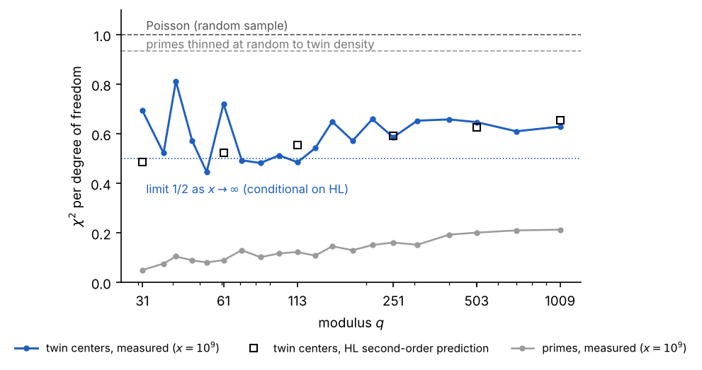
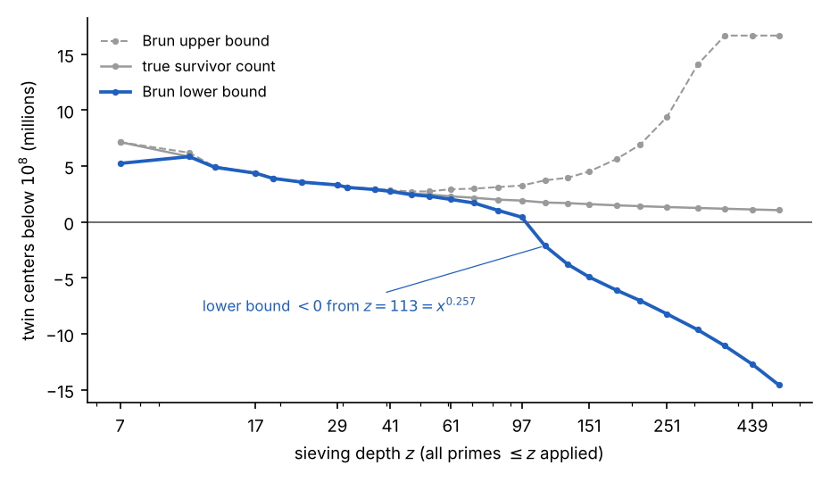
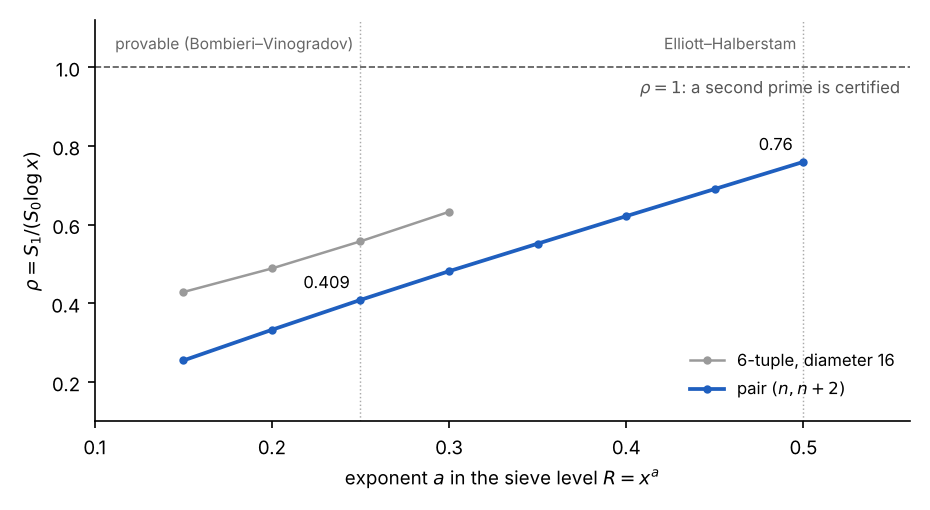

# Introduction

Every prime above $3$ is of the form $6k\pm 1$, so every prime is born as half of a candidate twin pair; the twin prime conjecture asks whether infinitely many pairs survive sieving by all larger primes. Tracking the centers $n$ with $6\mid n$, both $n\pm1$ survive sieving by the primes $\le p$ exactly when $n\not\equiv\pm1 \pmod r$ for every prime $r\le p$; each odd prime forbids two residues, which is the origin of the factor $\prod(r-2)$ and of the Hardy–Littlewood constant $$C_2=\prod_{r\ge3}\frac{1-2/r}{(1-1/r)^2}=0.660161\ldots,\qquad \pi_2(x)\sim 2C_2\int_2^x\frac{dt}{\log^2 t}.$$

This note concerns the *fluctuations* of twin primes across residue classes, rather than their count. For primes, the variance across the $\varphi(q)$ classes mod $q$ is classical: Hooley’s conjecture \[3\] that $\sum_a\bigl(\psi(x;q,a)-x/\varphi(q)\bigr)^2\sim x\log q$, the Montgomery–Hooley theorem on average over $q$ \[6, 3\], Friedlander–Goldston \[1\], the analysis of its range by Fiorilli \[2\], and the function-field theorem of Keating and Rudnick \[4\]. For twin primes in arithmetic progressions, the published results are Barban–Davenport–Halberstam-type bounds averaged over many moduli (Lavrik, Maier–Pomerance, Mikawa, Balog; see the summary in \[8\]), not an asymptotic at a fixed modulus; Parry \[9\] remarks that no asymptotic formula for the variance of twins in progressions is recorded. The sums of singular series restricted to residue classes that such an asymptotic requires were established by Kuperberg \[5\], generalising Montgomery and Soundararajan \[7\], and applied there to the Lemke Oliver–Soundararajan bias; the twin-prime variance corollary is not stated.

## Statement

Fix a prime $q\ge5$, write $\kappa=q-2$ for the number of admissible classes, $t(n)$ for the twin-center indicator, $T_c=\#\{n\le x: t(n)=1,\ n\equiv c\ (q)\}$ and $T=\sum_c T_c$. Define $$X^2(x;q)=\frac{1}{\kappa-1}\sum_{c\ \mathrm{adm.}}\frac{(T_c-T/\kappa)^2}{T/\kappa}.$$ For a random sample of size $T$ from the admissible classes, $E[X^2]=1$.

**Conjecture 1** (Hardy–Littlewood, uniform form). *For even $h\ne0$, uniformly for $|h|\le x$, $$\sum_{n\le x} t(n)\,t(n+h) = \mathfrak{S}_4(h)\int_2^x\frac{dt}{\log^4 t}\,(1+o(1)),\qquad \mathfrak{S}_4(h)=\mathfrak{S}(\{-1,1,h-1,h+1\}).$$*

**Proposition 2**. *Assume Conjecture <a href="#HL" data-reference-type="ref" data-reference="HL">1</a>. Then for every fixed prime $q\ge5$, $$E\bigl[X^2(x;q)\bigr] = \frac12 + O\!\Bigl(\frac{\log q}{\log x}\Bigr)\qquad (x\to\infty).$$ More precisely, with $\rho(h)=\mathfrak{S}_4(h)/(2C_2)^2$ and $A=1/(24C_2)$, $$E\Bigl[\sum_c (T_c-T/\kappa)^2\Bigr]=T\Bigl(1-\frac1\kappa\Bigr)\Bigl[1-6A\,\frac{T}{x}\log^2 x\,\bigl(1+O(\log q/\log x)\bigr)\Bigr],$$ and $T/x=2C_2/\log^2x\,(1+O(1/\log x))$.*

The argument is at the level of rigour of Montgomery–Soundararajan’s derivation of the variance of primes in short intervals: the leading term is derived, and the lower-order terms are evaluated numerically rather than closed in formula. Section <a href="#sec:derivation" data-reference-type="ref" data-reference="sec:derivation">2</a> gives the derivation, Section <a href="#sec:numerics" data-reference-type="ref" data-reference="sec:numerics">3</a> the numerical comparison, and Section <a href="#sec:context" data-reference-type="ref" data-reference="sec:context">4</a> the wheel-based experiments that led to the question.

# Derivation

## Reduction to singular-series sums

Since $\sum_c(T_c-T/\kappa)^2=\sum_cT_c^2-T^2/\kappa$ and $\sum_cT_c^2$ counts ordered pairs in a common class, $$\label{eq:red}
E\Bigl[\sum_c (T_c-T/\kappa)^2\Bigr]=T\Bigl(1-\frac1\kappa\Bigr)+2\sum_{h\ge1}\Bigl[\mathbf 1_{q\mid h}-\frac1\kappa\Bigr]\rho(h)\,D(h),$$ where $D(h)=\sum_{n\le x-h}\delta(n)\delta(n+h)$, $\delta(n)=2C_2/\log^2n$, so $D(h)\approx D(0)(1-h/x)$ and $D(0)=x\,(T/x)^2(1+O(1/\log x))$. The mean of $\rho$ over all $h$ is $1$ and over $h\equiv0\ (q)$ is $q/\kappa$, the local factor at $q$; hence the main terms of the two sums in <a href="#eq:red" data-reference-type="eqref" data-reference="eq:red">[eq:red]</a> cancel and everything depends on the second-order terms of $$R(H)=\sum_{h\le H}\rho(h),\qquad R_q(H)=\sum_{h\le H,\ q\mid h}\rho(h).$$

## Ramanujan expansion of $\rho$

For $p\ge5$ the local factor of $\rho$ is $$f_p(h)=\begin{cases}1/(1-2/p), & p\mid h,\\ (1-3/p)/(1-2/p)^2, & h\equiv\pm2\ (p),\\ (1-4/p)/(1-2/p)^2, & \text{otherwise},\end{cases}$$ and for $p=2,3$ the factor is $6\cdot\mathbf 1_{6\mid h}$. Each $f_p$ has mean $1$ over residues; its Fourier coefficients at $a\ne0$ are $|\mathrm{e}(a/p)+\mathrm{e}(-a/p)|^2/(p-2)^2$. Multiplying out, $$\label{eq:ram}
\rho(h)=6\cdot\mathbf 1_{6\mid h}\sum_{(d,6)=1}\frac{\mu^2(d)}{\varphi_2(d)^2}\prod_{p\mid d}\bigl[2c_p(h)+c_p(h+2)+c_p(h-2)\bigr],\qquad \varphi_2(d)=\prod_{p\mid d}(p-2),$$ with $c_p$ the Ramanujan sum. (Check: the bracket is $2p-4$, $p-4$, $-4$ in the three cases, reproducing $f_p$.) The analogous expansion for prime pairs is $\mathfrak{S}(h)=\sum_d\mu^2(d)c_d(h)/\varphi(d)^2$, and the method below applied to it yields $\sum_{h\le H}\mathfrak{S}(h)=H-\frac12\log H+O(1)$, the Montgomery–Soundararajan value; this calibrates the method.

## Partial sums and the double pole

For $d>1$ each bracket in <a href="#eq:ram" data-reference-type="eqref" data-reference="eq:ram">[eq:ram]</a> has mean zero over a period, so its partial sums over $h\le H$ do not grow. Writing the bracket in additive characters, the non-oscillating part of $\sum_{h\le H}\mathrm{e}(bh/d)$ is $-\frac12$, and the cotangent terms cancel by the symmetry $a\leftrightarrow -a$ of the coefficients. The saturated value is $-\frac12$ times the sum of the Fourier coefficients, $$\sum_{a\bmod d}^{*}\prod_{p\mid d}4\cos^2(2\pi a_p/p)=\prod_{p\mid d}(2p-4)=2^{\omega(d)}\varphi_2(d).$$ Hence, with $K=H/6$, $$\label{eq:R}
R(H)=H-3\,S(K)+O(1),\qquad S(Y)=\sum_{\substack{1<d\le Y\\ (d,6)=1}}\frac{\mu^2(d)\,2^{\omega(d)}}{\varphi_2(d)}.$$ The Dirichlet series of the summand is $\prod_{p\ge5}\bigl(1+2/((p-2)p^s)\bigr)=\zeta(1+s)^2G(s)$, a double pole, with $$G(0)=\Bigl(1-\tfrac12\Bigr)^2\Bigl(1-\tfrac13\Bigr)^2\prod_{p\ge5}\frac{(p-1)^2}{p(p-2)}=\frac19\cdot\frac{3}{4C_2}=\frac1{12C_2}.$$ Therefore $S(Y)=A\log^2Y+B\log Y+C+o(1)$ with $$A=\frac{G(0)}{2}=\frac{1}{24C_2}=0.06312\ldots$$ For primes the corresponding series $\sum\mu^2(d)/\varphi(d)$ has a simple pole, which is why the pair correlation carries $\frac12\log H$ rather than $\log^2H$.

## The restricted sum

For $q\mid h$, separate $d$ by whether $q\mid d$. If $q\nmid d$ the bracket averages over the progression as before. If $q\mid d$, the factor at $q$ is the bracket at $h\equiv0$, namely $2q-4=2\kappa$, divided by $\kappa^2$, i.e. $2/\kappa$; together the two cases give the factor $1+2/\kappa=q/\kappa$ and a sum over $d$ coprime to $6q$: $$R_q(H)=\frac H\kappa-3\,\frac q\kappa\,S_q\!\Bigl(\frac H{6q}\Bigr)+O(1),$$ with $S_q$ the sum $S$ restricted to $q\nmid d$. Removing the Euler factor at $q$ multiplies the leading asymptotic by $\kappa/q$, so $$\label{eq:diff}
R_q(H)-\frac{R(H)}\kappa=-\frac3\kappa\Bigl[(\kappa-1)A\log^2\tfrac H6-\kappa A\bigl(2\log q\log\tfrac H6-\log^2q\bigr)+O(\log H)\Bigr].$$

## The limit

Insert <a href="#eq:diff" data-reference-type="eqref" data-reference="eq:diff">[eq:diff]</a> into <a href="#eq:red" data-reference-type="eqref" data-reference="eq:red">[eq:red]</a> with the weight $D(h)\approx D(0)(1-h/x)$ by partial summation, using $\frac1x\int_0^x\log^2(u/6)\,du=\log^2x+O(\log x)$: $$E\Bigl[\sum_c (T_c-T/\kappa)^2\Bigr]=T\Bigl(1-\frac1\kappa\Bigr)\Bigl[1-6A\,\frac Tx\,\log^2x\,\bigl(1+O(\log q/\log x)\bigr)\Bigr].$$ With $T/x=2C_2/\log^2x\,(1+O(1/\log x))$ the logarithms cancel and $$E[X^2]\longrightarrow 1-12AC_2=1-12\cdot\frac1{24C_2}\cdot C_2=\frac12.$$ The twin prime constant cancels; the limit is universal in $q$. The first correction, $-(2\log q/\log x)$ times the deficit, makes the ratio rise with $q$ at finite $x$, as observed. For comparison, for primes the deficit is $2\cdot\frac12\log(x/q)\cdot(1/\log x)=1-\log q/\log x$, so $E[X^2]\approx\log q/\log x\to0$: one logarithm supplied, one removed, only the $q$-dependent remainder survives.

**Remark 3**. *Numerically, $S(Y)-A\log^2Y$ is linear in $\log Y$ (slope $0.52$) for $Y\le10^5$, confirming $A$. The $O(1)$ in <a href="#eq:R" data-reference-type="eqref" data-reference="eq:R">[eq:R]</a> is an offset of about $13$–$15$ from the range $d>H/6$ where the Ramanujan partial sums are not saturated; it does not affect the leading term, but a complete treatment in the Montgomery–Soundararajan framework—with Conjecture <a href="#HL" data-reference-type="ref" data-reference="HL">1</a> carrying an explicit error $O(x^{1/2+\varepsilon})$, the oscillatory terms bounded, and $B$, $C$ and their $q$-dependence written out from $G'(0)$, $G''(0)$—is left open. Kuperberg’s Theorem 1.2 \[5\] treats sums over all $k$-subsets of $[1,h]$ with prescribed residues; the sum needed here runs over the one-parameter family $\{-1,1,h-1,h+1\}$, so the mechanism was applied directly rather than her theorem quoted. A rigorous conditional version should be a corollary of her framework.*

# Numerical comparison

The prediction can be evaluated without any asymptotics: compute $\rho(h)$ exactly for all $h\le x$ by a multiplicative sieve over the primes $\le x$, and evaluate <a href="#eq:red" data-reference-type="eqref" data-reference="eq:red">[eq:red]</a> with $D(h)$ replaced by $(T/x)^2(x-h)$. Table <a href="#tab:pred" data-reference-type="ref" data-reference="tab:pred">1</a> compares this with the measured $X^2$ at $x=10^7,10^8,10^9$ (twin pairs with a member below $1000$ are excluded, because the wheel kills its own generators: the center of $(5,7)$ is $6\equiv1\pmod5$). The twin counts used were checked against the published values $58{,}980$, $440{,}312$, $3{,}424{,}506$ and $27{,}412{,}679$ below $10^7,\dots,10^{10}$.

|  $q$ | $x=10^7$ pred. / meas. | $x=10^8$ pred. / meas. | $x=10^9$ pred. / meas. |
|-----:|:----------------------:|:----------------------:|:----------------------:|
|   31 |     0.481 / 0.479      |     0.485 / 0.460      |     0.486 / 0.694      |
|   61 |     0.528 / 0.614      |     0.526 / 0.470      |     0.523 / 0.721      |
|  113 |     0.569 / 0.490      |     0.561 / 0.578      |     0.554 / 0.485      |
|  251 |     0.619 / 0.563      |     0.605 / 0.596      |     0.593 / 0.586      |
|  503 |     0.660 / 0.618      |     0.640 / 0.651      |     0.625 / 0.647      |
| 1009 |     0.699 / 0.709      |     0.674 / 0.669      |     0.655 / 0.629      |

Exact second-order Hardy–Littlewood prediction of $E[X^2]$ versus measurement. The sampling standard deviation of $X^2$ is $\sqrt{2/(\kappa-1)}$: $0.27$ at $q=31$, $0.13$ at $q=113$, $0.04$ at $q=1009$. The two $10^9$ outliers are the two lowest-dof rows and lie within one standard deviation.

Three features are visible. The predictions match the measurements within noise at every modulus and scale. Every prediction decreases monotonically with $x$ ($q=1009$: $0.699$, $0.674$, $0.655$), at the rate the $2\log q/\log x$ correction implies, toward the limit $\frac12$. And the measured values for the primes at the same $x$ are $0.05$–$0.21$, following $\log q/\log x$ (Figure <a href="#fig:rig" data-reference-type="ref" data-reference="fig:rig">1</a>). Thinning the primes at random to twin density gives $X^2\approx1-\rho_{\mathrm{thin}}=0.93$, so the selection “$p+2$ is also prime” is far from independent across a class; the deficit from $0.93$ to $0.6$ is the pair-of-pairs correlation.

<figure id="fig:rig">

<figcaption><em>X</em>2 for primes and for twin centers across residue classes mod <em>q</em> at <em>x</em> = 109, with the exact second-order Hardy–Littlewood prediction (squares) and the conditional limit $\frac12$.</figcaption>
</figure>

Six other statistics of the twin centers to $10^8$ were tested and found to agree with the wheel-plus-Hardy–Littlewood model to the precision available: divisibility of centers by small primes ($P(r\mid n)=1/(r-2)$ to four digits), the $2$-adic valuation (geometric), the counts of prime pairs at distances $4,6,210,246$ relative to distance $2$ (singular-series ratios to four digits), the two-point Möbius sum $\sum\mu(n)\mu(n+2)$ (random-walk size), the distribution of $\omega(n)$ among survivors at fixed sieving depth (no effect once size bias is removed), and a $\lambda(a)$-weighted residual of $\#\{b: ab\text{ a twin center}\}$ against the wheel model (within $1.7\sigma$ in every dyadic block to $a=16384$).

# Context: the wheel experiments

The question arose from a sequence of experiments on the primorial-wheel formulation. We record them briefly because they locate, with numbers, the point at which each classical method stops.

#### The wheel.

Let $p\#$ be the primorial. The candidates for primes above $p$ in one period are the units mod $p\#$, obtained recursively by tiling the units mod $(p^-)\#$ $p$ times and removing $p$ times each of them; the count is $\prod_{r\le p}(r-1)$ (Euler, by the Chinese Remainder Theorem) and the twin-surviving count is $\prod_{r\le p}(r-2)$. The ratio $\prod_{r\ge3}(1-2/r)/(1-1/r)^2$ converges to $C_2$; computed from the wheel it reaches $0.660162$ by $r=10^5$. The wheel for $p$ certifies primes only below the square of the next prime.

#### The error term of the sieve.

In a window of length $10^7$, the rule “each prime kills $2/r$ of the remaining centers” is exact to $0.01\%$ for $r\le71$ and drifts to $-12\%$ by $r=1789$. Sieving to $\sqrt x$ with the product rule overcounts twins by $4\mathrm{e}^{-2\gamma}\approx1.26$ (and primes by $2\mathrm{e}^{-\gamma}\approx1.12$); the measured ratio true/predicted is $0.922$ at $10^7$, sliding toward $0.79$.

#### Brun’s bounds.

Truncating inclusion–exclusion at depth $r$ with error $2^{\omega(d)}$ per term gives bracketing bounds on the survivor count. At $x=10^8$ the lower bound is positive only for sieving depth $z\le97$ and turns negative at $z=113=x^{0.257}$, while the true count stays above $10^6$ throughout (Figure <a href="#fig:brun" data-reference-type="ref" data-reference="fig:brun">2</a>). Survivors at that depth have all prime factors above $113$, so each of $n\pm1$ has at most $3$ prime factors; certifying primes needs depth $x^{1/2}$.

<figure id="fig:brun">

<figcaption>Brun’s bounds for the twin-center survivor count below 108 as a function of sieving depth. The main term is accurate to 1% at <em>z</em> = 113; the error budget ∑<em>j</em>2<em>j</em><em>C</em>(<em>m</em>,<em>j</em>) is what fails.</figcaption>
</figure>

#### GPY weights.

Replacing survival by the Goldston–Pintz–Yıldırım weight $w(n)=\sum_{d\mid(n-1)(n+1),\,d\le R}\lambda_d$ and computing $\rho=S_1/(S_0\log x)$ on the real primes at $x=10^7$: for the pair, $\rho=0.409$ at $R=x^{1/4}$ (the provable level, $\theta=\frac12$) and $0.760$ at $R=x^{1/2}$ (Elliott–Halberstam); extrapolating, $\rho=1$ would need $R\approx x^{0.66}$, i.e. $\theta\approx1.3>1$ (Figure <a href="#fig:gpy" data-reference-type="ref" data-reference="fig:gpy">3</a>). This is the numerical face of the known fact that pair weights cannot certify two primes at any admissible level of distribution, and that Maynard’s multidimensional weights need $k\approx105$ at $\theta=\frac12$, whence bounded gaps of $600$, later $246$, but not $2$.

<figure id="fig:gpy">

<figcaption>GPY ratio <em>ρ</em> for the pair (<em>n</em>,<em>n</em>+2) and for a 6-tuple of diameter 16, as a function of the sieve level <em>R</em> = <em>x</em><em>a</em>, on the real primes to 107.</figcaption>
</figure>

#### Summary.

The main term is right (counts to four digits, fluctuations to within noise); honest counting cannot afford the depth (Brun dies at $x^{0.26}$); weighting fixes the budget but caps the pair ($\rho<1$ for all $\theta\le1$). No statistic measured to $10^{10}$ departs from the wheel-plus-Hardy–Littlewood model, which is consistent with Selberg’s parity obstruction: any structure visible in residue statistics is Type I information, and Type I information provably cannot distinguish a prime from a product of two large primes.

# Reproducibility

All computations are in plain Python with NumPy (and one C program for the exact $\rho(h)$ sums: $0.2$ s, $2$ s and $34$ s for $x=10^7,10^8,10^9$ on a 2-core machine). The scripts are available from the author.

# Acknowledgements

The computations, literature search and drafting were carried out with the assistance of Claude (Anthropic), an AI system, in an interactive session on 1–2 November 2026; the author is responsible for the content.

99 J. B. Friedlander, D. A. Goldston, Variance of distribution of primes in residue classes, *Quart. J. Math. Oxford* (2) 47 (1996), 313–336. D. Fiorilli, The distribution of the variance of primes in arithmetic progressions, *Int. Math. Res. Not.* (2015); arXiv:1301.5663. C. Hooley, On the Barban–Davenport–Halberstam theorem: I–VI, *J. reine angew. Math.*, *J. London Math. Soc.* (1975–1976). J. P. Keating, Z. Rudnick, The variance of the number of prime polynomials in short intervals and in residue classes, *Int. Math. Res. Not.* 2014 (1), 259–288; arXiv:1204.0708. V. Kuperberg, Sums of singular series along arithmetic progressions and with smooth weights, *Int. J. Number Theory* 21 (2025), 53–74; arXiv:2301.06095. H. L. Montgomery, Primes in arithmetic progressions, *Michigan Math. J.* 17 (1970), 33–39. H. L. Montgomery, K. Soundararajan, Primes in short intervals, *Comm. Math. Phys.* 252 (2004), 589–617. S. Palimar, Twin prime polynomials in function field, arXiv:1909.13745. T. Parry, An average theorem for tuples of $k$-free numbers in arithmetic progressions, *Mathematika* 67 (2021), 1–18; arXiv:1912.03376.

